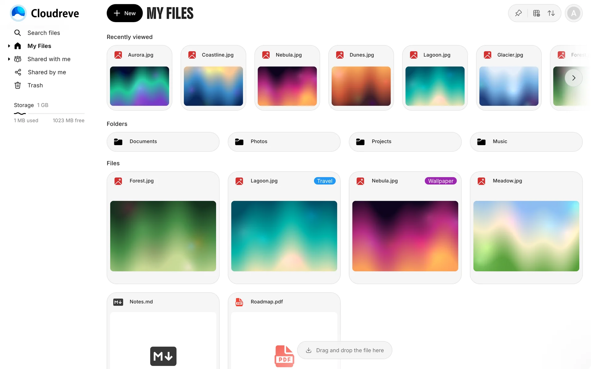
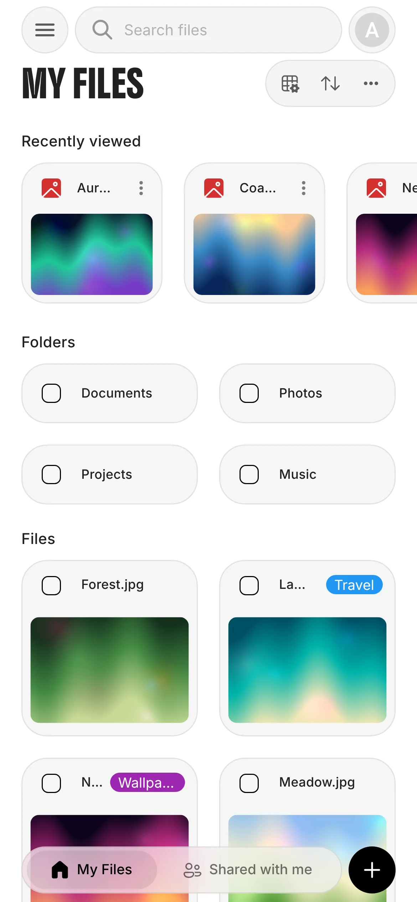
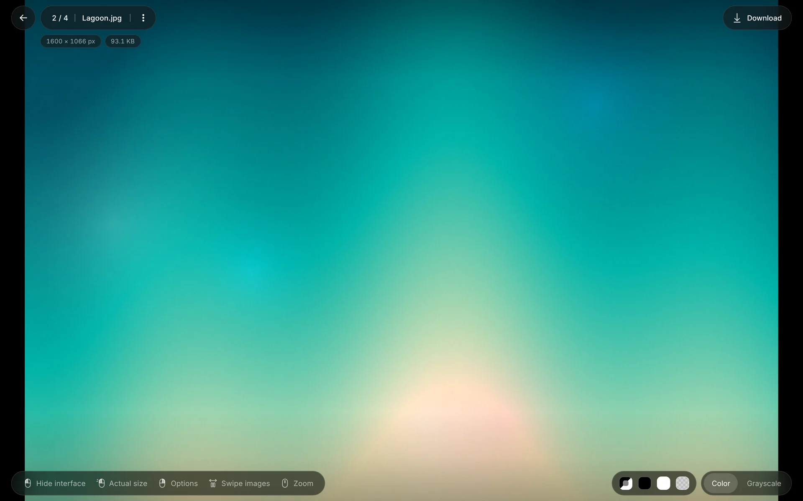

<h1 align="center">Obscura</h1>

<p align="center">
A visual redesign for <a href="https://github.com/cloudreve/cloudreve">Cloudreve</a>, featuring a recent files list and an enhanced image viewer.<br>
It is a single HTML that sits in the <strong>Custom footer HTML</strong> setting.<br>
</p>

<p align="center">


</p>
<p align="center">
  
</p>


## Features

- Files: Reorder folders pinned on the sidebar; custom folder colors and emojis are always shown.
- Files: Single click opens files and folders. Drag-select and drag onto folders work in gallery view.
- Files: A row of the files you last opened, at the root of My Files and of share links.
- Image viewer: Top pills with filename, resolution, file size and ICC colour profile.
- Image viewer: Background swatches (System, black, white, checkerboard) and Color/Grayscale proofing.
- Image viewer: Keyboard, wheel, trackpad pinch and swipe navigation, a hint legend and custom cursors.
- Image viewer: Right-click menu on the photo.
- Image viewer: Thumbnail strip on phones; on desktop, a peek of the previous or next image follows the cursor while it points that way.
- Image viewer: Video viewer with a dark frame that keeps the video in place while it loads.
- Phones: Bottom navigation (My Files / Shared with me) and a floating + button.
- Phones: Pinned path bar, frosted sidebar.
- Phones: Edge-to-edge viewer with native pinch zoom and double-tap zoom.
- Phones: Tuned for iOS Safari, including Liquid Glass status and address bar tinting, and landscape safe areas.
- Smaller changes: Tree view > Auto expand is off by default (each user can turn it back on).
- Smaller changes: The Finance settings tab is hidden.
- Smaller changes: Recovers from failed lazy-loaded chunks instead of showing Cloudreve's error page.

## Installation

1. Open **Dashboard → Settings → Site information → Custom footer HTML**.
2. Paste the loader below and save.
3. Clear Cloudreve cache from browser.
4. Reload page.

```html
<script>
(() => {
	const url = "https://raw.githubusercontent.com/domesticatedpigeon/cloudreve-theme-public/main/cloudreveCustomFooter.html";
	fetch(url + (url.includes("?") ? "&" : "?") + "t=" + Date.now(), { cache: "no-store" })
		.then((r) => r.text())
		.then((html) => {
			const box = document.createElement("div");
			box.innerHTML = html;
			box.querySelectorAll("style").forEach((s) => document.head.appendChild(s));
			box.querySelectorAll("script").forEach((s) => {
				const n = document.createElement("script");
				n.textContent = s.textContent;
				document.body.appendChild(n);
			});
		});
})();
</script>
```

The loader fetches the latest theme from this repository on every page load, so updates arrive automatically.

### Pin a version or self-host
- **Pin a version:** replace `main` in the URL with a commit hash or tag to stop automatic updates.
- **Self-host:** download `cloudreveCustomFooter.html`, serve it from your own domain (the response must allow your Cloudreve origin via CORS, or come from the same origin), and point `url` at it.
- **No loader:** paste the whole contents of `cloudreveCustomFooter.html` into Custom footer HTML. This works too, but you will have to paste it again for every update.

### External requests
The theme loads its fonts from Google Fonts and jsDelivr. If you configured iconify file icons in Cloudreve, the Recently viewed row loads them from the same Iconify API hosts Cloudreve uses.

## Development
- `cloudreveCustomFooter.html` is the whole theme: a flat list of `<style>` and `<script>` blocks.
- [`architecture.md`](architecture.md) explains how each feature hooks into Cloudreve, and [`design-language.md`](design-language.md) lists the visual rules.
- [`CLAUDE.md`](CLAUDE.md) covers conventions and how to test changes.
